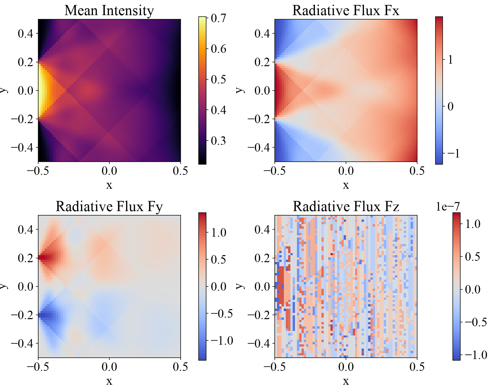

# 2D RT Test: Searchlight Beam

サーチライト問題は、輻射輸送 (RT) ソルバの標準的なテスト問題です。境界の一部から細い光束 (サーチライト) を計算領域に入射させ、光束がどの程度広がらずに伝わるかを見ることで、短特性法(short characteristics) {cite}`kunasz_1988JQSRT..39...67K` の数値拡散の大きさを確認します。

MISOのRTソルバは、離散化した方向ごとに輻射輸送方程式

$$
\frac{dI}{ds} = -\kappa \left(I - S\right)
$$

を短特性法で積分します。ここで$I$は輻射強度、$s$は光線に沿った距離、$\kappa$は吸収係数、$S$は源泉関数です。角度積分にはCarlsonのA4求積 (24方向) を用います。

## Location

`demo/rt2d_searchlight/`

## Geometry

- $-0.5 \leq x \leq 0.5$
- $-0.5 \leq y \leq 0.5$

$z$方向は1格子点のみで、2次元問題として扱います。

## Setup

計算領域全体で吸収係数と源泉関数を一様に

$$
\kappa = 1, \quad S = 0.5
$$

とします。`config.yaml` の `searchlight` セクションで変更できます。

## Boundary Conditions

$x$方向内側の境界 ($x = -0.5$) のうち $\sqrt{y^2 + z^2} \leq 0.2$ の範囲から、内向きの全方向に強度 $I = 1$ の輻射を入射させます。それ以外の境界からの入射強度は $0$ です。$y$方向と$z$方向は周期境界条件です。

入射させる境界面 (`boundary_face`)、半径 (`radius`)、入射強度 (`incoming_intensity`) は `config.yaml` で変更できます。

## Results

このデモは時間発展を行わず、輻射場が収束するまで反復して1回だけ出力します。可視化用のPythonスクリプトが用意されています。結果のプロットは `demo/rt2d_searchlight/figs` に保存されます。

```shell
cd demo/rt2d_searchlight
python plot_data.py
```

平均強度 $J = \sum_r w_r I_r$ と輻射流束 $\bm{F} = 4\pi \sum_r w_r \bm{\mu}_r I_r$ の3成分を$x$-$y$面に描きます。ここで$w_r$、$\bm{\mu}_r$はそれぞれ方向$r$の重みと方向余弦です。境界から入った光束が、離散化した方向に沿って分かれて進む様子と、吸収によって減衰しながら源泉関数の値 $S = 0.5$ に近づく様子が見えます。2次元問題なので $F_z$ は丸め誤差程度の値になります。


